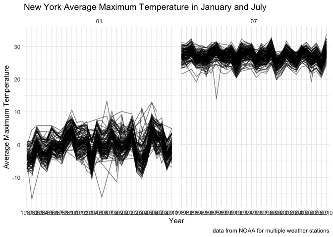
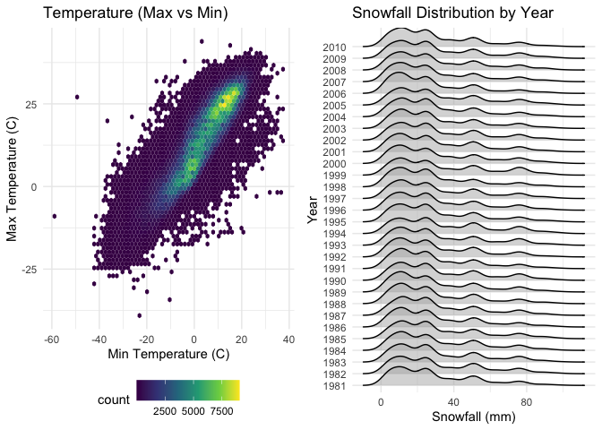
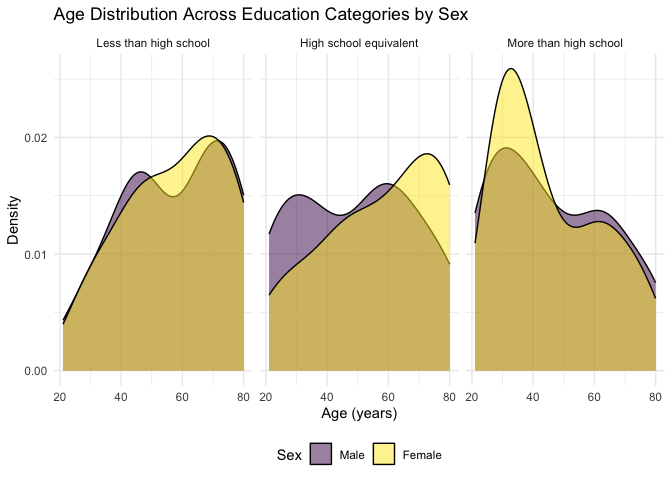
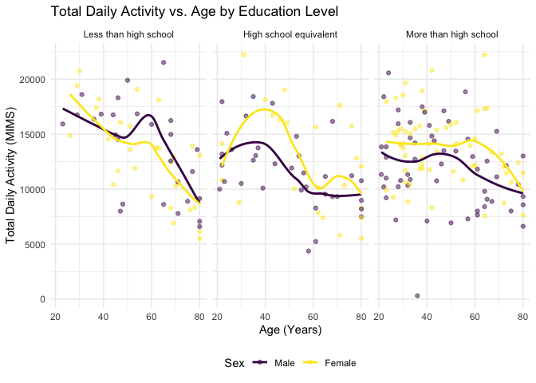
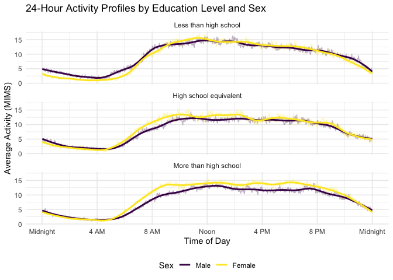
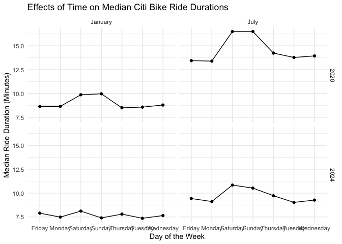
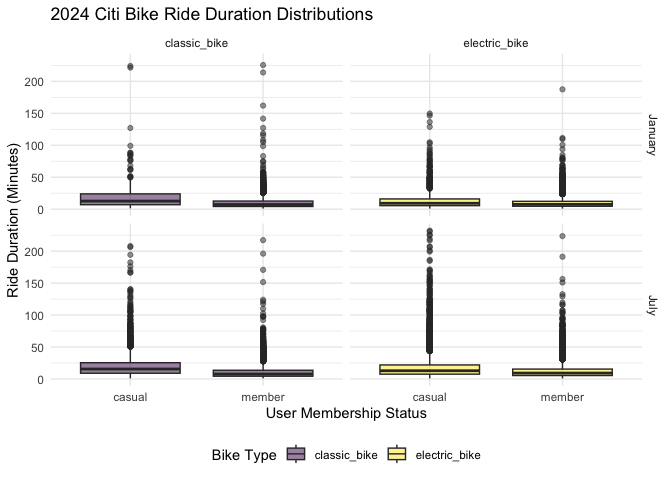

P8105 Homework 3
================
Jia Varkey
2026-10-09

## Problem 1

``` r
ny_noaa
```

    ## # A tibble: 2,595,176 × 7
    ##    id          date        prcp  snow  snwd tmax  tmin 
    ##    <chr>       <date>     <int> <int> <int> <chr> <chr>
    ##  1 US1NYAB0001 2007-11-01    NA    NA    NA <NA>  <NA> 
    ##  2 US1NYAB0001 2007-11-02    NA    NA    NA <NA>  <NA> 
    ##  3 US1NYAB0001 2007-11-03    NA    NA    NA <NA>  <NA> 
    ##  4 US1NYAB0001 2007-11-04    NA    NA    NA <NA>  <NA> 
    ##  5 US1NYAB0001 2007-11-05    NA    NA    NA <NA>  <NA> 
    ##  6 US1NYAB0001 2007-11-06    NA    NA    NA <NA>  <NA> 
    ##  7 US1NYAB0001 2007-11-07    NA    NA    NA <NA>  <NA> 
    ##  8 US1NYAB0001 2007-11-08    NA    NA    NA <NA>  <NA> 
    ##  9 US1NYAB0001 2007-11-09    NA    NA    NA <NA>  <NA> 
    ## 10 US1NYAB0001 2007-11-10    NA    NA    NA <NA>  <NA> 
    ## # ℹ 2,595,166 more rows

The New York NOAA data set measures the precipitation as `prcp`, snow as
`snow`, and minimum and maximum temperatures of various New York cities
each day. This data set is exceptionally large with dimensions 7 by
2595176. There are multiple entries of missing data with the variables
`tmax` and `tmin` completely missing. This becomes an issue without
enough information to accurately analyze the data.

``` r
ny_noaa_clean =
  ny_noaa |>
  janitor::clean_names() |>
  drop_na() |>
  separate(date, into = c("year", "month", "day")) |>
  mutate(
     prcp = prcp / 10,
     tmax = as.numeric(tmax) / 10,
     tmin = as.numeric(tmin) / 10
  ) # converting temperature from tenths of degrees celsius to degrees celsius, precipitation to tenths of mms to mms


ny_noaa_clean |>
  count(snow) |>
  arrange(desc(n))
```

    ## # A tibble: 248 × 2
    ##     snow       n
    ##    <int>   <int>
    ##  1     0 1112758
    ##  2    25   15809
    ##  3    13   12460
    ##  4    51    9252
    ##  5     5    5669
    ##  6     8    5380
    ##  7    76    5296
    ##  8     3    5276
    ##  9    38    5050
    ## 10   102    3386
    ## # ℹ 238 more rows

The most common observed values for snowfall is 0 mm observed 1112758
times and 25 mm observed 15809 times. For most of the year in Spring,
Summer, and Fall it does not snow at all in New York. It also does not
snow every day in Winter. So, the most commonly observed amount of
snowfall for the whole year would be 0 mm.

``` r
jan_july_temp =
  ny_noaa_clean |>
  filter(month %in% c("01", "07")) |>
  group_by(id, year, month) |>
  summarize(mean_tmax = mean(tmax, na.rm = TRUE), .groups = "drop")

jan_july_temp |>
  ggplot(aes(x = year, y = mean_tmax, group = id)) +
  geom_line(alpha = .5) +
  facet_grid(~month) +
  labs(
    title = "New York Average Maximum Temperature in January and July",
    x = "Year",
    y = "Average Maximum Temperature",
    color = "Location",
    caption = "data from NOAA for multiple weather stations"
  )
```

    ## Ignoring unknown labels:
    ## • colour : "Location"

<!-- -->

January has a lower overall average mean temperature than July. January
has more variation and outliers across the years compared to July.

``` r
# tmax vs tmin for the full dataset 
temp_plot =
  ny_noaa_clean |>
  ggplot(aes(x=tmin, y = tmax)) +
  geom_hex(bins=60) +
  labs(
    title = "Temperature (Max vs Min)",
    x = "Min Temperature (C)",
    y = "Max Temperature (C)"
    )

#snow distribution 
snow_dist =
  ny_noaa_clean |>
  filter(snow > 0, snow < 100) |>
  group_by(year) |>
  ggplot(aes(x = snow, y = year)) +
  geom_density_ridges(alpha=.5) +
   labs(
    title = "Snowfall Distribution by Year",
    x = "Snowfall (mm)",
    y = "Year"
)

#Two-panel plot
gridExtra::grid.arrange(temp_plot, snow_dist, ncol = 2)
```

    ## Picking joint bandwidth of 4.24

<!-- -->

## Problem 2

``` r
demo_df = read_csv("~/Documents/P8105 Data Science/viz_and_eda/p8105_hw3_jv3014/nhanes_covar.csv", skip = 4) |>
  janitor::clean_names() |>
  drop_na()
```

    ## Rows: 250 Columns: 5
    ## ── Column specification ────────────────────────────────────────────────────────
    ## Delimiter: ","
    ## dbl (5): SEQN, sex, age, BMI, education
    ## 
    ## ℹ Use `spec()` to retrieve the full column specification for this data.
    ## ℹ Specify the column types or set `show_col_types = FALSE` to quiet this message.

``` r
accel_df = read_csv("nhanes_accel.csv") |>
  janitor::clean_names()
```

    ## Rows: 250 Columns: 1441
    ## ── Column specification ────────────────────────────────────────────────────────
    ## Delimiter: ","
    ## dbl (1441): SEQN, min1, min2, min3, min4, min5, min6, min7, min8, min9, min1...
    ## 
    ## ℹ Use `spec()` to retrieve the full column specification for this data.
    ## ℹ Specify the column types or set `show_col_types = FALSE` to quiet this message.

``` r
nhanes = inner_join(demo_df, accel_df, by = "seqn") |>
  filter(age >= 21) |>
    mutate(
    sex = case_match(
      sex,
      1 ~ "Male",
      2 ~ "Female"
    ),
    sex = factor(sex, levels = c("Male", "Female")),
    
    education = case_match(
      education,
      1 ~ "Less than high school",
      2 ~ "High school equivalent",
      3 ~ "More than high school"
    ),
    education = factor(
      education, 
      levels = c("Less than high school", "High school equivalent", "More than high school"),
      ordered = TRUE
    )
  )
```

``` r
gender_edu =
  nhanes |>
  group_by(sex, education) |>
  summarize(count. = n()) |>
  knitr::kable(caption = "Participant Count by Education Level and Sex")
```

    ## `summarise()` has grouped output by 'sex'. You can override using the `.groups`
    ## argument.

``` r
age_edu =
  nhanes |>
  select(age, sex, education) |>
  ggplot(aes(x = age, fill = sex)) +
  geom_density(alpha = .5) +
  facet_grid(.~education) +
  labs(
    title = "Age Distribution Across Education Categories by Sex",
    x = "Age (years)",
    y = "Density",
    fill = "Sex"
  )

gender_edu
```

| sex    | education              | count. |
|:-------|:-----------------------|-------:|
| Male   | Less than high school  |     27 |
| Male   | High school equivalent |     35 |
| Male   | More than high school  |     56 |
| Female | Less than high school  |     28 |
| Female | High school equivalent |     23 |
| Female | More than high school  |     59 |

Participant Count by Education Level and Sex

``` r
age_edu
```

<!-- -->

The highest concentration of participants resides in the “More than high
school” tier. In contrast, fewer individuals fall into the remaining
tiers, meaning trends derived from the highest education group may show
more statistical stability. Within the Less than high school and High
school equivalent cohorts, the age curve leans significantly toward
older individuals (skewed heavily toward ages 60–80). Within the More
than high school tier, the distribution slopes in the opposite
direction. It features a prominent peak of younger adults (ages 20–40),
demonstrating that higher education levels skew younger within this
sample.

``` r
total_activity_df = 
  nhanes |> 
  pivot_longer(
    cols = starts_with("min"),
    names_to = "minute",
    values_to = "mims"
  ) |>
  group_by(seqn, sex, age, education) |>
  summarize(total_activity = sum(mims), .groups = "drop")

ggplot(total_activity_df, aes(x = age, y = total_activity, color = sex)) +
  geom_point(alpha = 0.5) +
  geom_smooth(se = FALSE, method = "loess") +
  facet_grid(. ~ education) +
  labs(
    title = "Total Daily Activity vs. Age by Education Level",
    x = "Age (Years)",
    y = "Total Daily Activity (MIMS)",
    color = "Sex"
  )
```

    ## `geom_smooth()` using formula = 'y ~ x'

<!-- -->

Across all education cohorts, total movement patterns reliably degrade
as individuals age. In the Less than high school cohort, males exhibit
marginally higher movement totals across middle age, but lines cross as
they advance past age 60. In the High school equivalent and More than
high school brackets, females maintain a higher volume of daily activity
across almost all life stages compared to males.

``` r
diurnal_df = 
  nhanes |>
  pivot_longer(
    cols = starts_with("min"),
    names_to = "minute",
    values_to = "mims"
  ) |>
  mutate(minute = as.numeric(str_remove(minute, "min"))) |>
  group_by(minute, sex, education) |>
  summarize(mean_mims = mean(mims), .groups = "drop")

ggplot(diurnal_df, aes(x = minute, y = mean_mims, color = sex)) +
  geom_line(alpha = 0.3) +
  geom_smooth(aes(group = sex), method = "loess", span = 0.15, se = FALSE) +
  facet_wrap(~ education, nrow = 3) +
  scale_x_continuous(
    breaks = seq(0, 1440, by = 240),
    labels = c("Midnight", "4 AM", "8 AM", "Noon", "4 PM", "8 PM", "Midnight")
  ) +
  labs(
    title = "24-Hour Activity Profiles by Education Level and Sex",
    x = "Time of Day",
    y = "Average Activity (MIMS)",
    color = "Sex"
  )
```

    ## `geom_smooth()` using formula = 'y ~ x'

<!-- -->

All groups activity drops to near zero during expected sleeping hours
(11 PM to 5 AM), spikes sharply between 6 AM and 9 AM as individuals
wake up, and tapers down in the late evening.

## Problem 3

This zip file contains data on rides taken on the NYC Citi Bike system.
Files contain 1% of all rides with a total duration less than 4 hours in
each of four months. Import, clean, and tidy these data, and describe
the resulting dataset.

``` r
library(lubridate)

jan_20 = read_csv("citibike/Jan 2020 Citi.csv.zip") |>
  mutate(year = 2020, month = "January")
```

    ## Rows: 12420 Columns: 7
    ## ── Column specification ────────────────────────────────────────────────────────
    ## Delimiter: ","
    ## chr (6): ride_id, rideable_type, weekdays, start_station_name, end_station_n...
    ## dbl (1): duration
    ## 
    ## ℹ Use `spec()` to retrieve the full column specification for this data.
    ## ℹ Specify the column types or set `show_col_types = FALSE` to quiet this message.

``` r
jan_24 = read_csv("citibike/Jan 2024 Citi.csv.zip") |>
  mutate(year = 2024, month = "January")
```

    ## Rows: 18861 Columns: 7
    ## ── Column specification ────────────────────────────────────────────────────────
    ## Delimiter: ","
    ## chr (6): ride_id, rideable_type, weekdays, start_station_name, end_station_n...
    ## dbl (1): duration
    ## 
    ## ℹ Use `spec()` to retrieve the full column specification for this data.
    ## ℹ Specify the column types or set `show_col_types = FALSE` to quiet this message.

``` r
jul_20 = read_csv("citibike/July 2020 Citi.csv.zip") |>
  mutate(year = 2020, month = "July")
```

    ## Rows: 21048 Columns: 7
    ## ── Column specification ────────────────────────────────────────────────────────
    ## Delimiter: ","
    ## chr (6): ride_id, rideable_type, weekdays, start_station_name, end_station_n...
    ## dbl (1): duration
    ## 
    ## ℹ Use `spec()` to retrieve the full column specification for this data.
    ## ℹ Specify the column types or set `show_col_types = FALSE` to quiet this message.

``` r
jul_24 = read_csv("citibike/July 2024 Citi.csv.zip") |>
  mutate(year = 2024, month = "July")
```

    ## Rows: 47156 Columns: 7
    ## ── Column specification ────────────────────────────────────────────────────────
    ## Delimiter: ","
    ## chr (6): ride_id, rideable_type, weekdays, start_station_name, end_station_n...
    ## dbl (1): duration
    ## 
    ## ℹ Use `spec()` to retrieve the full column specification for this data.
    ## ℹ Specify the column types or set `show_col_types = FALSE` to quiet this message.

``` r
data = bind_rows(jan_20, jan_24, jul_20, jul_24)

citibike =
  data |>
  janitor::clean_names() |>
  drop_na() |>
  filter(duration < 240)
```

The final tidied dataset contains thousands of observations representing
a 1% sample of trips under 4 hours. The columns clearly document the
bike type (classic vs. electric), trip timing, station endpoints, and
user membership category.

``` r
citibike |>
group_by(year, month, member_casual) |>
summarise(total_rides = n(), .groups = "drop") |>
pivot_wider(names_from = member_casual, values_from = total_rides, values_fill = 0) |>
mutate(Total = casual + member) |>
rename(Year = year, Month = month, `Casual Riders` = casual, `Citi Bike Members` = member) |>
knitr::kable(caption = "Total Number of Rides")
```

| Year | Month   | Casual Riders | Citi Bike Members | Total |
|-----:|:--------|--------------:|------------------:|------:|
| 2020 | January |           980 |             11418 | 12398 |
| 2020 | July    |          5625 |             15388 | 21013 |
| 2024 | January |          2094 |             16705 | 18799 |
| 2024 | July    |         10843 |             36200 | 47043 |

Total Number of Rides

There is a substantial increase in overall ridership from 2020 to 2024.
Summer ridership (July) drastically outpaces winter ridership (January)
across both user types due to favorable weather conditions. Citi Bike
Members consistently represent the vast majority of trips. This is
especially visible during January, confirming that members rely heavily
on the system for year-round, utilitarian daily commuting, while casual
riders are more active during warm weather.

``` r
citibike |>
filter(year == 2024, month == "July", !is.na(start_station_name)) |>
group_by(start_station_name) |>
summarise(Number_of_Rides = n(), .groups = "drop") |>
slice_max(order_by = Number_of_Rides, n = 5) |>
knitr::kable(caption = "Five Most Popular Citibike Starting Stations July 2024")
```

| start_station_name       | Number_of_Rides |
|:-------------------------|----------------:|
| Pier 61 at Chelsea Piers |             163 |
| University Pl & E 14 St  |             155 |
| W 21 St & 6 Ave          |             152 |
| West St & Chambers St    |             150 |
| W 31 St & 7 Ave          |             145 |

Five Most Popular Citibike Starting Stations July 2024

``` r
median_duration_df <- citibike |>
  group_by(year, month, weekdays) |>
  summarise(median_duration = median(duration), .groups = "drop")

ggplot(median_duration_df, aes(x = weekdays, y = median_duration, group = interaction(year, month))) +
  geom_line() +
  geom_point() +
  facet_grid(year ~ month) +
  labs(
    title = "Effects of Time on Median Citi Bike Ride Durations",
    x = "Day of the Week",
    y = "Median Ride Duration (Minutes)"
  ) 
```

<!-- -->

Across all panels, the median ride duration spikes significantly on
Saturdays and Sundays compared to weekdays. July trips have a higher
median duration than January trips. Colder weather in January naturally
discourages lingering rides. The median ride durations are generally
shorter in 2024 than in 2020.

``` r
citibike_2024 = citibike |>
  filter(year == 2024)

ggplot(citibike_2024, aes(x = member_casual, y = duration, fill = rideable_type)) +
  geom_boxplot(alpha = 0.5) +
  facet_grid(month ~ rideable_type) +
  labs(
    title = "2024 Citi Bike Ride Duration Distributions",
    x = "User Membership Status",
    y = "Ride Duration (Minutes)",
    fill = "Bike Type"
  )
```

<!-- -->

Electric bike trips show a much tighter distribution with a lower median
duration than classic bikes. Because ebikes travel faster, trips are
completed quicker. Casual riders have a much wider distribution spread
with longer tail ends (higher variance) regardless of bike type. Members
display highly predictable, compact distributions centered around
shorter trip lengths (10–15 minutes). July pushes both groups to extend
their classic bike rides longer, causing a rightward skew in the
distribution density compared to January.
